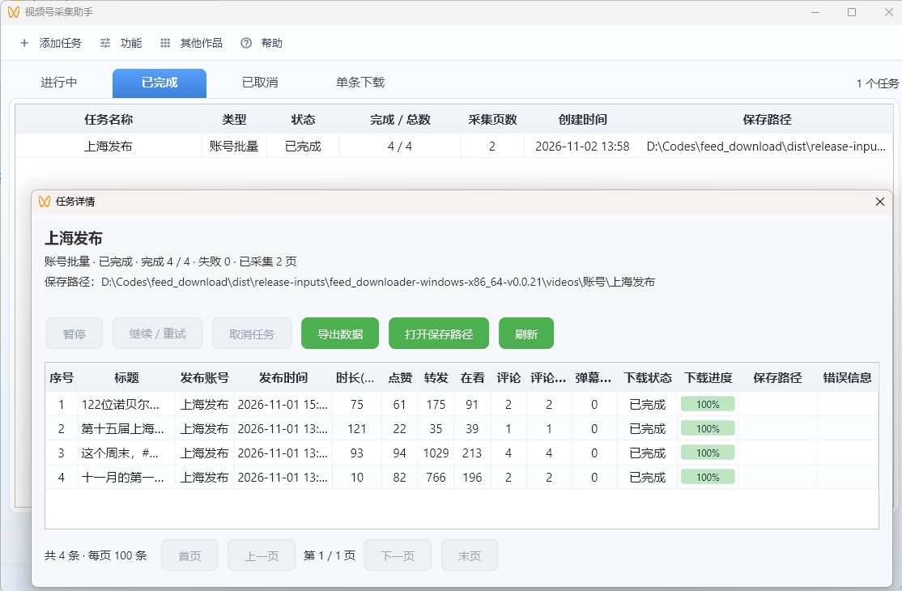

# 视频号采集助手

保存视频号的视频、图集、作品信息，以及可选的评论、二级回复和弹幕，支持账号批量、关键词和聊天记录采集。

## 开始使用

完整使用教程可以看 [使用教程](docs/使用教程.md)

网盘下载地址： `https://wwbmk.lanzoue.com/b068vkaij 密码:gxs4`

1. 从 Release 下载对应平台的 ZIP，完整解压到可写目录。
2. Windows 运行 `feed_downloader.exe`；macOS 打开 `.app`；Linux 运行 `feed_downloader`。不要只复制一个 EXE。
3. 设置有效卡密，在“功能 → 默认下载路径”确认目录，再从“添加任务”选择采集方式。

Windows 需要 **Windows 10/11 64 位，不支持 Windows 7**。聊天记录查询和自动下载只支持Windows；macOS、Linux 不提供这两项功能。

#### 根据需求选择采集方式

| 方式 | 适合什么情况 |
| --- | --- |
| 账号批量 | 搜索并选择账号，按时间范围采集作品 |
| 关键词 | 设置关键词和采集页数，自动采集结果 |
| 聊天记录 | 查询文件传输助手，勾选多个视频后作为一个任务提交 |
| 链接、自动下载 | 单条视频下载，在“单条下载”页管理 |

账号、关键词和聊天记录任务在主界面统一管理。**右键任务**可查看详情、暂停、继续、取消、导出数据和打开目录。账号、关键词也可只采集信息，不下载视频。

创建任务时可按需启用评论、弹幕，默认关闭；启用后默认采集全部，也可限制每个视频的页数或条数。任务详情显示每个视频已采集的评论数量和弹幕数量，不在软件中展示正文。已有作品、互动数据及扩展字段均可导出 Excel / CSV。

#### MCP服务

AI 客户端连接见 [MCP 服务](docs/MCP.md)。

#### 问题反馈

遇到错误后，在“帮助 → 导出诊断包”生成 ZIP 提供排查，也可“打开日志目录”。日志自动脱敏并轮转，诊断包不包含配置、数据库或视频；业务服务退出后仍可导出。日志从新版启用后开始记录。

