# 视频号采集助手使用教程

原来的“视频号下载助手”已重写为“视频号采集助手”。新版主要变化：

- 支持 Windows、macOS、Linux 三个平台。
- 新增按关键词采集。
- 账号、关键词、聊天记录任务统一管理，可暂停、继续、取消；软件重启后未完成的任务可以继续。
- 可以只采集作品信息，不下载视频文件。
- 新增评论（含二级回复）和弹幕采集。
- 作品、评论、弹幕数据可导出为 Excel 或 CSV。
- 新增日志和诊断包，出错时便于排查。

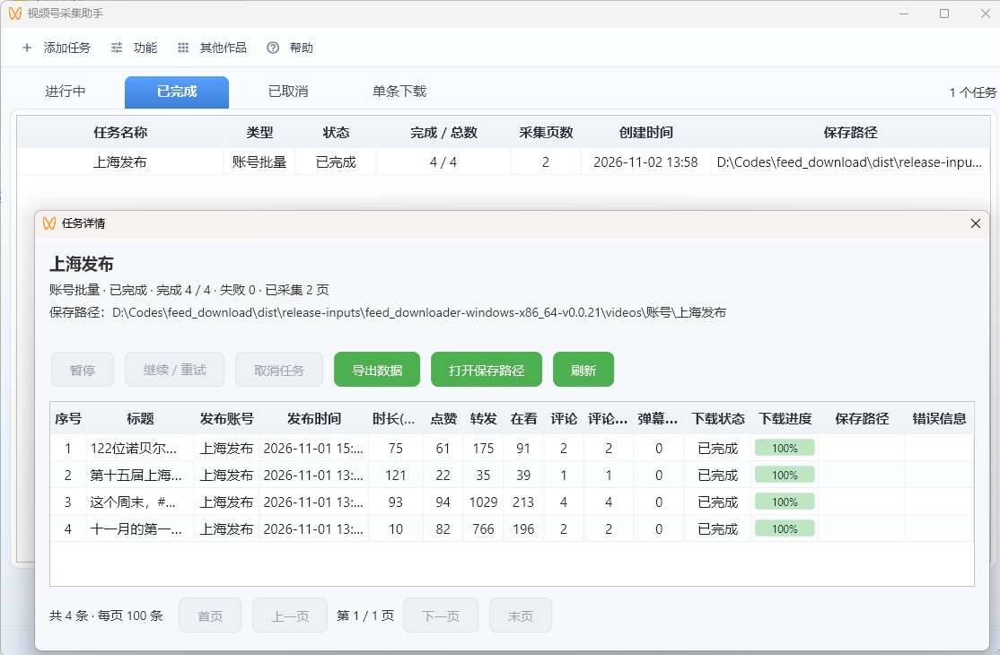

## 一、下载与安装

### 系统要求

| 系统 | 要求 |
| --- | --- |
| Windows | Windows 10/11 64 位 |
| macOS | Apple 芯片（arm64） |
| Linux | x64 |

“按视频”“最近记录”和“自动下载” 是Windows独有的功能。

### 安装步骤

`https://wwbmk.lanzoue.com/b068vkaij 密码:gxs4`

1. 从网盘下载对应系统的 ZIP。
2. 把 ZIP 完整解压到一个有写入权限的目录。
3. 启动程序：
   - Windows：运行 `feed_downloader.exe`。
   - macOS：打开 `.app`。如果系统提示无法验证开发者，在 Finder 中右键该程序选择“打开”。
   - Linux：运行 `feed_downloader`。

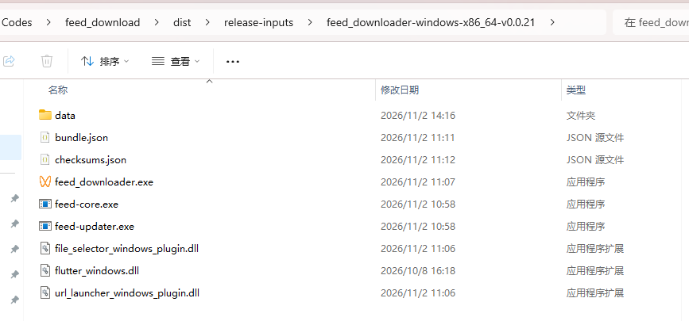

### 从旧版升级

去网盘下载新版然后通过邮箱查询到之前的积分(也可以从config.ini将token复制到新软件)，之后的新版本在“帮助 → 检查更新”中升级，软件也会每天自动检查一次。

## 二、设置下载路径

“功能 → 默认下载路径 → 设置路径”。修改后只对新任务生效，已有任务和视频不移动。

默认保存结构：

| 来源 | 保存位置 |
| --- | --- |
| 通过链接、自动下载 | `videos\` |
| 按账号 | `videos\账号\账号名称\` |
| 按关键词 | `videos\关键词\关键词\` |
| 按视频（聊天记录） | 窗口里指定的路径，留空则为 `videos\` |

下载视频时会同时保存 `.jpg` 封面。同一目录下已有完整文件的视频会直接跳过，不重复下载。

## 三、添加任务

所有入口都在“添加任务”菜单下。

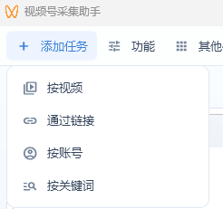

| 方式 | 适用场景 | 平台 |
| --- | --- | --- |
| 通过链接 | 下载单个视频 | 全部 |
| 按账号 | 批量采集某个账号的作品 | 全部 |
| 按关键词 | 批量采集搜索结果 | 全部 |
| 按视频 | 从文件传输助手中挑选视频 | Windows |
| 自动下载 | 转发到文件传输助手后自动下载 | Windows |

### 1. 通过链接

1. 在微信中复制视频号的分享链接，例如 `https://weixin.qq.com/sph/xxxx`。
2. 打开“添加任务 → 通过链接”，粘贴链接。
3. 按需勾选“采集评论”“采集弹幕”（见第五节）。
4. 点“添加”，解析成功后进入下载队列。

任务显示在“单条下载”页。

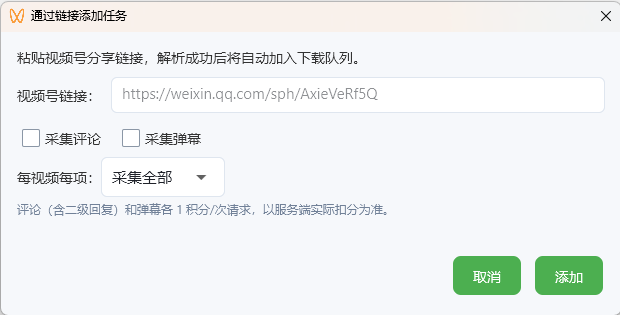

### 2. 按账号

1. 打开“添加任务 → 按账号”。
2. 输入视频号用户名、昵称或 `@finder` 账号 ID，点“搜索账号”。
3. 在结果表格中选择账号。结果不全时点“加载下一页”。
4. 设置开始时间和结束时间，格式为 `YYYY-MM-DD HH:MM:SS`。默认从 2000-01-01 开始，即全部作品。
5. 类型选“视频”或“直播回放”。
6. 只需要作品信息时，取消勾选“同时下载视频文件”。
7. 按需勾选评论、弹幕，点“创建任务”。

Windows 上还可以点“最近记录”，从文件传输助手最近两小时的视频号消息中选择账号，不需要搜索。

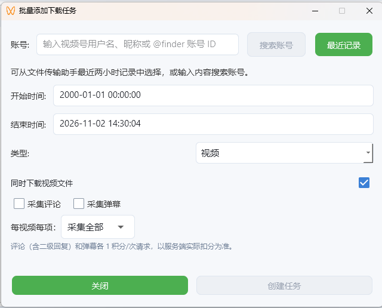
>
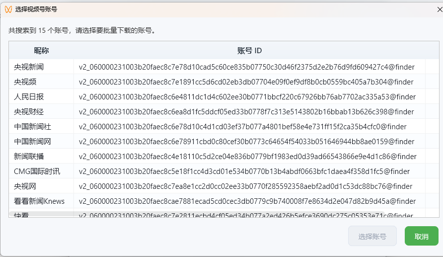

### 3. 按关键词

1. 打开“添加任务 → 按关键词”。
2. 输入关键词，设置采集页数（1–100）。结果不足时自动结束。
3. 按需取消“同时下载视频文件”，勾选评论、弹幕。
4. 点“创建任务”。

搜索结果全部采集，不需要逐条选择。

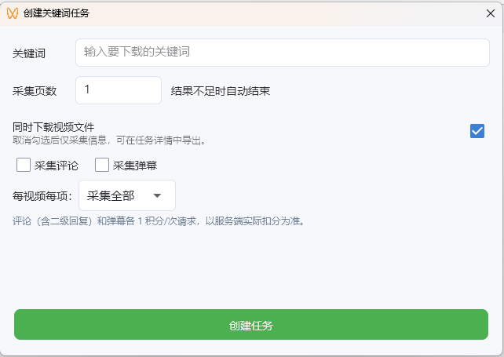

### 4. 按视频（Windows）

适合一次下载多个指定视频。

1. 在手机或电脑微信中，把视频号视频转发到“文件传输助手”。
2. 打开“添加任务 → 按视频”。
3. 设置开始、结束时间，点“查询”。
4. 勾选要下载的视频，或点“全选”。
5. 按需设置下载路径，勾选评论、弹幕。
6. 点“下载”。所选视频作为一个任务提交。

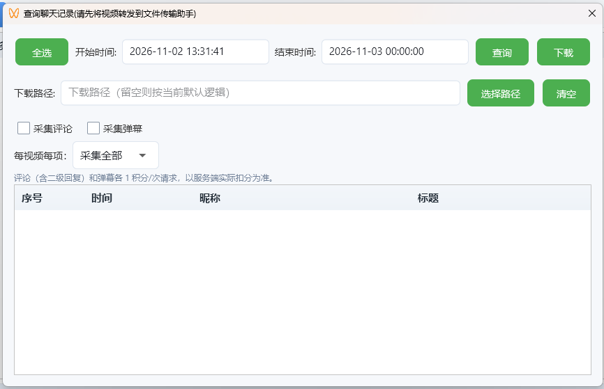

### 5. 自动下载（Windows）

1. 点“功能 → 自动下载”，前面出现勾选即为开启。
2. 之后转发到文件传输助手的视频号视频会自动加入下载，显示在“单条下载”页。
3. 自动下载是否采集评论、弹幕，在“功能 → 自动采集选项”中设置，只对之后加入的视频生效。

## 四、采集评论和弹幕

“通过链接”“按账号”“按关键词”“按视频”的窗口里都有这组选项，默认不勾选。

| 选项 | 说明 |
| --- | --- |
| 采集评论 | 包含一级评论和二级回复 |
| 采集弹幕 | 视频弹幕 |
| 每视频每项：采集全部 | 不设上限 |
| 每视频每项：最大页数 | 1–10000 页，二级回复的请求也计入页数 |
| 每视频每项：最大条数 | 1–1000000 条，包含二级回复 |

上限对每个视频的评论和弹幕分别计算，达到上限即停止该项采集。

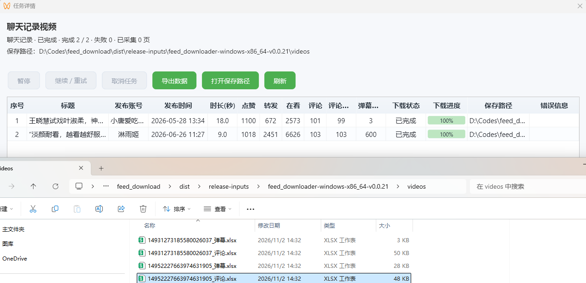

采集结果：

- 每个视频在任务目录下生成 `视频ID_评论.xlsx` 和 `视频ID_弹幕.xlsx`。
- 软件内不显示评论和弹幕正文。任务详情的“评论数量”“弹幕数量”列显示本地已保存的条数（去重后）。
- 视频已经下载过，勾选后仍会采集评论弹幕，不重新下载视频。
- 暂停或失败后继续，从断点接着采，已保存的数据保留。

评论表包含：视频ID、视频标题、发布账号、评论ID、回复目标ID、根评论ID、用户ID、昵称、评论正文、评论时间、点赞、地区、回复内容，以及头像、回复数等扩展字段。

弹幕表包含：视频ID、视频标题、发布账号、弹幕ID、弹幕正文、视频位置（毫秒）、发送时间、点赞，以及弹幕类型、来源等扩展字段。

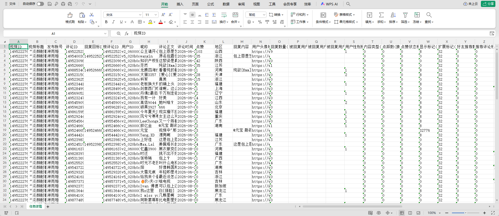

## 五、管理任务

关闭软件不会丢失任务。重新打开后，未完成的任务处于暂停状态，点“继续 / 重试”即可。

任务详情显示每个视频的标题、发布账号、发布时间、时长、点赞、转发、在看、评论、评论数量、弹幕数量、下载状态、下载进度和保存路径。

## 六、导出数据

1. 在任务上右键，选“导出数据”。任务详情窗口里也有“导出数据”按钮。
2. 选择保存位置，文件类型选 Excel（`.xlsx`）或 CSV（`.csv`）。

说明：

- 导出任务的全部记录，不受当前分页限制。
- 任务未完成或部分失败也可以导出。
- 导出只读取本地数据，不扣积分。
- 除列表中的字段外，还包含地区、账号资料、原创标记、媒体规格等扩展字段。
- Excel 单元格超长时，内容拆到相邻的“续”列。

评论和弹幕的表格在采集时已自动生成，见第五节。

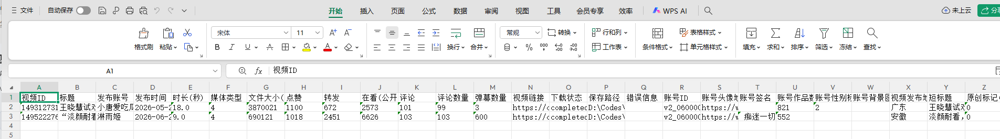

## 七、数据备份与问题反馈

### 数据位置

Windows 版所有数据都在程序目录：

| 内容 | 位置 |
| --- | --- |
| 配置、卡密 | `settings.json` |
| 任务记录、缓存 | `data.db` |
| 日志 | `logs\` |
| 默认下载目录 | `videos\` |

macOS 数据在 `~/Library/Application Support/Pygrower/feed_downloader`，Linux 在 `~/.local/share/feed_downloader`。

备份或换电脑：先退出软件，再复制整个程序目录。下载路径设在其他位置的，需要另外备份。

### 问题反馈

遇到错误时，点“帮助 → 导出诊断包”，生成 ZIP 发给作者。诊断包里的日志已脱敏，不包含卡密、配置、数据库和视频。

“帮助 → 打开日志目录”可直接查看日志。

## 八、MCP 服务（可选）

软件可以通过 MCP 让 AI 客户端创建任务、查询进度和导出数据。

1. 打开“功能 → MCP 服务”，点“启动服务”。默认地址为 `http://127.0.0.1:8766/mcp`。
2. 点“复制连接配置”，粘贴到 AI 客户端的 MCP 配置中，连接方式选 Streamable HTTP。

默认只允许本机访问。需要局域网访问时，修改绑定 IP，并启用“Bearer Token 鉴权”。

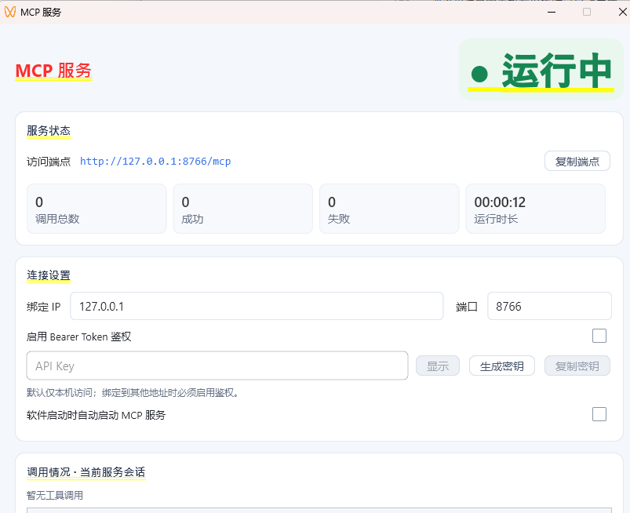
